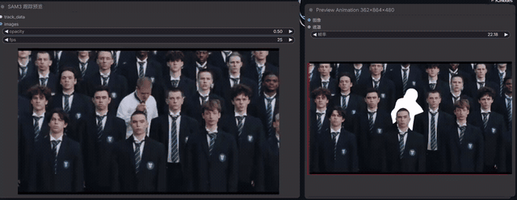
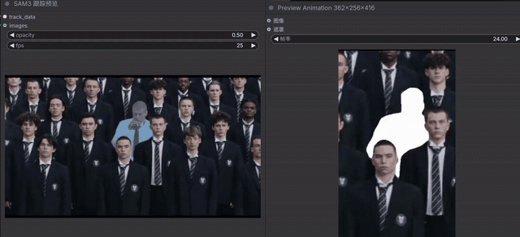

# ComfyUI SAM + WeVisOne-VL Recovery

**中文** | [English](README_EN.md)

**ComfyUI 人物跟踪丢失后自动找回：WeVisOne-VL 4B 识别目标，SAM3 继续跟踪。**

一个 ComfyUI 人物替换工作流：用 WeVisOne-VL 指定目标，SAM3 生成视频蒙版；当蒙版连续为空时，尝试用 WeVisOne 找回目标，再从找回的帧重新运行 SAM3。示例工作流可将蒙版用于 MiniMax H3 人物替换。

项目包含基于 [flybirdxx/ComfyUI-WeVisOne](https://github.com/flybirdxx/ComfyUI-WeVisOne) 的本地适配，以及自动纠错、共享模型和共享人物描述节点。它是社区项目，不是腾讯或 ComfyUI 官方项目。

## 实际案例：人物进入人群后找回

左侧为 SAM3 跟踪预览，右侧为纠错后蒙版。两侧预览可能不同步，仅用于展示效果，不是逐帧对比。

### 人群中的蒙版与裁切预览

左侧展示 SAM3 跟踪预览，右侧展示人物局部蒙版预览。两个预览窗口可能不同步，效果需要结合实际帧逐一检查。

## 项目来源和分工

- [Tencent/WeVisOne-VL](https://github.com/Tencent/WeVisOne-VL)：视觉语言识别模型，用于根据描述定位并分割人物。本项目使用 4B 模型。
- [flybirdxx/ComfyUI-WeVisOne](https://github.com/flybirdxx/ComfyUI-WeVisOne)：WeVisOne 的 ComfyUI 节点实现。本项目包含其适配版本，并修改后端以共享模型会话。
- [SAM3](https://github.com/facebookresearch/sam3)：根据目标蒙版进行视频目标跟踪；本项目通过 ComfyUI SAM3 节点接口进行调用。
- 本项目增加首帧识别、空蒙版检测、按间隔重新识别和 SAM3 重启跟踪，以及 MiniMax H3 示例工作流。

本项目为独立社区整合，不代表以上项目官方发布。各模型、源码和依赖遵循各自许可。

## 工作方式

1. 从视频片段取第一帧，按照人物描述用 WeVisOne 4B 生成初始蒙版。
2. SAM3 跟踪整个片段；纠错节点检查每帧蒙版。
3. 连续空蒙版达到阈值后，从丢失帧开始按间隔调用 WeVisOne。
4. 按最后有效蒙版的位置筛选候选。候选过近而无法区分时跳过；成功后把该帧蒙版送给 SAM3，重新跟踪剩余帧并拼接。
5. 输出修复后蒙版供预览、人物裁切和 H3 使用。

默认连续空 **3 帧**触发、每 **12 帧**尝试一次、最多尝试 120 次。间隔单位是帧而不是秒；可按视频帧率调整。WeVisOne 模型在首帧和纠错之间通过工作流中的 session 共享，内存由 ComfyUI 调度；模型可能因为显存压力被卸载并重新加载。

## 我们做了哪些改动

- 基于 flybirdxx 的 ComfyUI-WeVisOne 版本，扩展模型会话，让首帧识别与纠错共用 WeVisOne 模型实例。
- 增加首帧分割、自动纠错和统一人物描述三个节点；首帧必须识别到唯一目标，避免一开始就选错人。
- 自动检查 SAM 输出的每一帧蒙版；示例工作流中连续 3 帧为空时，以 12 帧为间隔尝试找回，最多尝试 120 次。
- 用目标最后一次出现的位置筛选 WeVisOne 候选，位置过于接近时跳过；找回后重新运行 SAM3，并将结果拼接到原蒙版序列。
- 在人物替换工作流中接入纠错后的蒙版，并保留参考视频尺寸、蒙版预览和统一的目标人物描述。

## 给 SAM3 的提示和输入

这里的“提示”指识别到的人物蒙版，不是向 SAM3 反复发送文字提示词：

1. 在 **CLIP文本编码：统一人物描述** 输入目标外观描述，该文字同时传给 WeVisOne 首帧识别和后续找回。例如 `the man wearing a white shirt in the foreground`；描述应尽量包含衣服、位置等易区分特征。
2. WeVisOne 在首帧识别出唯一目标后，将该目标的**首帧蒙版**作为 SAM3 VideoTrack 的 `initial_mask`，并传入视频帧和 SAM3 模型。示例中 SAM3 的 `conditioning` 没有连接，因此人物描述不直接作为 SAM3 的文本提示。
3. 跟踪丢失后，WeVisOne 在检测帧上找到符合位置条件的候选人物，将该帧的**新蒙版**作为 SAM3 的 `initial_mask`，与从此帧开始的剩余视频一起重新送入 SAM3 VideoTrack；纠错时限制为一个目标。
4. 找回前未被补上的空帧可能仍为空；若 WeVisOne 误认路人，SAM3 也可能继续跟踪错误对象。最终身份与遮挡效果要靠预览确认。

注意：上述 3 帧、12 帧和 120 次是**示例工作流的设置**；单独新增纠错节点时，其节点默认值可能不同，请以界面中的实际数值为准。

## 重要限制

- 检测的是空蒙版，**无法可靠检测 SAM 跟到了错误的人**。位置最近不等于身份正确；拥挤、相似服装或运动距离较大时可能误认或拒绝找回。请逐段查看纠错后蒙版预览和控制台报告。
- 完全遮挡或无法可靠识别时，不会凭空生成可信蒙版。1—2 帧空蒙版默认不会触发纠错；单帧蒙版闪烁和切换边缘差异也不保证修复。
- 首帧分割要求只检测到一个目标；请使用能区分目标的描述。目标被多个人遮挡时可能需要换帧、人工选人或手动修蒙版。
- 连续尝试会多次调用 4B 推理，较耗时、耗显存；识别过于频繁或多个视频并发时应调整间隔与尝试次数。
- 重运行 SAM 会从找回帧处理剩余视频。该方案没有外观身份识别或自动质量验收。
- 这是一个基于本地环境构建的工作流；模拟验证了连线、候选筛选与 SAM 重启，尚未对不同设备、ComfyUI 版本和视频做全面端到端验证。

## 依赖

- 支持 SAM3 视频跟踪及 V3 节点 API 的 ComfyUI。
- Python 3.10 及以上；Windows / RTX 3090 24GB 是原开发环境。
- 此仓库包含 `custom_nodes/ComfyUI-WeVisOne` 和 `custom_nodes/ComfyUI-WeVisOne-Recovery` 两个目录。前者来自 flybirdxx，修改了 backend 以支持单次工作流内共享模型；后者实现自动纠错。
- 示例 H3 工作流还需要 [ComfyUI-KJNodes](https://github.com/kijai/ComfyUI-KJNodes)、[ComfyUI-VideoHelperSuite](https://github.com/Kosinkadink/ComfyUI-VideoHelperSuite)、[MaskVidExperiments](https://github.com/drozbay/MaskVidExperiments) 及工作流中其他节点。可使用 ComfyUI Manager 检查缺失节点。
- 模型：腾讯官方 [WeVisOne-VL 4B](https://huggingface.co/tencent/WeVisOne-VL-4B)、SAM3.1 Multiplex 模型及与该示例匹配的 MiniMax H3 模型、视频与音频 VAE、文本编码器。模型权重未包含在本仓库。

## 安装

1. 把本仓库的两个 `custom_nodes` 子目录复制到 ComfyUI 的 `custom_nodes/`。若已有 flybirdxx 版本，先备份：共享模型需要本项目附带的 backend 修改。
2. 阅读 `custom_nodes/ComfyUI-WeVisOne/requirements.txt`，在 ComfyUI Python 环境中先执行依赖检查或 `pip install --dry-run -r <requirements路径>`。先确认没有不希望的 Torch、CUDA、Transformers 或 OpenCV 变更，再按需安装。不要把 WeVisOne 官方项目的整套固定依赖直接覆盖到正在使用的 ComfyUI 环境。
3. 下载完整的 WeVisOne-VL 4B 文件夹，包括 `model.safetensors`、`mask_decoder.pt`、`config.json`、tokenizer、processor 配置和模板，放在 `ComfyUI/models/wevisone/WeVisOne-VL-4B/`。文件不齐时不能使用。4B 官方模型文件较大，实际占用以下载版本为准。
4. 安装 SAM3.1 与 H3 模型；路径和文件名以各模型的安装说明及工作流节点为准。
5. 完全退出并重启 ComfyUI，导入 `workflows/minimax_h3_wevisone_sam_recovery.json`，重新选择自己的参考视频和人物图片。

## 使用

在 **CLIP文本编码：统一人物描述** 中描述原视频中需要替换的对象，例如 `the man wearing a white shirt in the foreground`。首帧识别与自动纠错使用同一段描述；H3 视频生成提示词仍在独立的提示词节点里。

`interval` 控制 WeVisOne 找回尝试间隔；`empty_frames` 是判定丢失所需的连续空帧数；`min_pixels` 和 `threshold` 决定蒙版是否被视为有效；`max_distance` 是与最后位置的距离上限，相对于画面对角线；`max_attempts` 限制找回尝试次数。

运行后检查“纠错后的蒙版预览”。控制台报告会记录候选数量、跳过原因和重新运行 SAM 的帧号。导出前逐帧检查人物遮挡、误选路人、蒙版闪烁及切换帧。

## 许可与致谢

项目按 Apache License 2.0 发布。`custom_nodes/ComfyUI-WeVisOne` 保留其原始 LICENSE、NOTICE、THIRD_PARTY 文件及上游归属。WeVisOne 源码、权重和其他依赖分别遵循其各自许可证；请查阅 [Tencent/WeVisOne-VL](https://github.com/Tencent/WeVisOne-VL)、[flybirdxx/ComfyUI-WeVisOne](https://github.com/flybirdxx/ComfyUI-WeVisOne) 和 [SAM3](https://github.com/facebookresearch/sam3)。