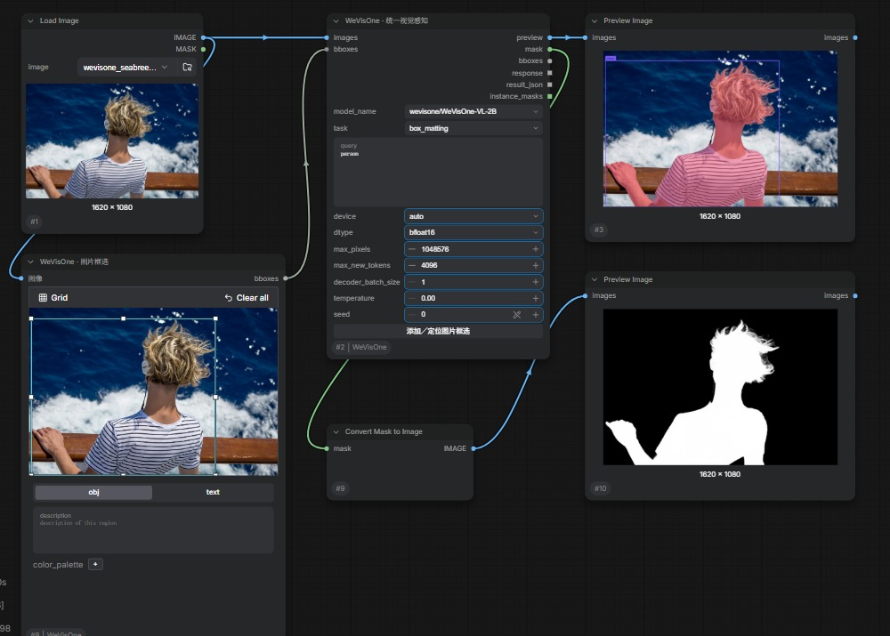
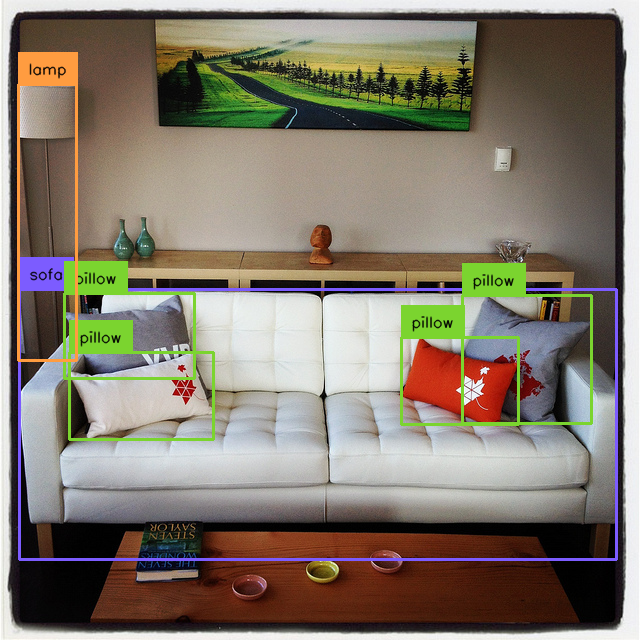

# ComfyUI-WeVisOne

[English](README.md) | 简体中文

ComfyUI nodes for Tencent **WeVisOne-VL** and **Mask2Alpha**. Reuses official inference code and runs in the existing ComfyUI process.

腾讯 [WeVisOne-VL](https://github.com/Tencent/WeVisOne-VL) 的独立 ComfyUI 集成，支持官方 2B／4B 模型与 [Mask2Alpha](https://github.com/Tencent/WeVisOne-VL/tree/mask2alpha)。复用官方模型、像素解码器和推理方法，不启动额外推理服务。

[示例工作流](examples/README_zh-CN.md) · [测试截图](#测试截图) · [上游来源](THIRD_PARTY.md) · [更新日志](CHANGELOG.md)

## 功能

| 节点 | 功能 |
| --- | --- |
| **WeVisOne · 统一视觉感知** | 检测、指代、指点、框／点计数、OCR、文字定位、分割、连续 alpha 抠图、参考框查找相似对象、自由提示词、框提示抠图 |
| **WeVisOne · Mask2Alpha 精细抠图** | 粗 MASK 精修、单框抠图、正负点击抠图；复用官方 SAM2.1-B+ 与精修头 |
| **WeVisOne · 图片框选** | 拖拽画框、移动、缩放；保持原图亮度，仅显示框线与八个手柄 |

框选复用 ComfyUI 原生组件；加载图片、MASK 预览、裁剪和透明图保存继续使用核心节点。模型由 ComfyUI 的 `ModelPatcher` 管理，支持生成中断。

## 测试截图

以下使用腾讯仓库的公开示例图片，在本地 RTX 5060 Ti 16 GB 上运行。截图和结果均来自实际推理；示例不能替代完整 benchmark。图片来源、参数和文件说明见 [assets/README_zh-CN.md](assets/README_zh-CN.md)。

**框选与 MASK 预览：** 在 ComfyUI 中直接画框，保持原图亮度，输出原分辨率掩码。



**4B 文本抠图：** query 为 `person`，左侧是输入原图，右侧是模型输出的连续 alpha。

| 输入原图 | 4B alpha 输出 |
| --- | --- |
|  |  |

**2B 目标检测：** 查询 `sofa`、`pillow`、`lamp`。



**2B OCR：** 实际文字区域与标签预览；保留原始结果，不修饰识别或字体显示上的局限。


## 环境要求

- 当前 ComfyUI V3 API，包含 `BOUNDING_BOXES`、`JoinImageWithAlpha` 等核心组件。
- Python ≥3.10；使用 ComfyUI 自带环境。
- 支持 Qwen3-VL 的 Transformers，已实测 **4.57.6**。兼容层适配新版 checkpoint 的配置格式，不要求 Transformers 5；4.57 以前缺少 Qwen3-VL 类的版本不在支持范围。
- 可工作的 Torch／Torchvision。GPU 实测为 RTX 5060 Ti 16 GB；其他设备和 CPU 路径未做完整模型验收。
- Mask2Alpha 另外需要官方 `sam2` 包；普通 VLM 任务不使用 SAM2。

## 安装

在 `ComfyUI/custom_nodes` 中克隆仓库，或解压 Release ZIP 到该目录：

```sh
git clone https://github.com/flybirdxx/ComfyUI-WeVisOne.git
```

使用 **ComfyUI 所在环境的 Python** 安装额外依赖。以下 Windows portable 命令在 portable 根目录执行，使用已有的 `uv`：

```powershell
.\python_embeded\Scripts\uv.exe pip install --python .\python_embeded\python.exe --dry-run -r ComfyUI\custom_nodes\ComfyUI-WeVisOne\requirements.txt
.\python_embeded\Scripts\uv.exe pip install --python .\python_embeded\python.exe -r ComfyUI\custom_nodes\ComfyUI-WeVisOne\requirements.txt
```

先检查 dry-run 输出，再执行安装。清单不指定 Torch／CUDA／Transformers 的升级；已有依赖满足条件时不需要重复安装。不要把原仓库锁定的整套 requirements 安装到 ComfyUI。

若需要 Mask2Alpha，但没有 `sam2`，按 [SAM2 官方安装说明](https://github.com/facebookresearch/sam2#installation)安装。对应上游子模块 revision 为 `2b90b9f5ceec907a1c18123530e92e794ad901a4`；Windows 可使用 `SAM2_BUILD_CUDA=0` 禁用可选 CUDA 扩展，保留现有 Torch 构建。

首次安装或新增／更新语言文件后，重启 ComfyUI 并刷新浏览器。

### 界面语言

节点名称、参数名称与提示、输出名称和框选按钮跟随 **ComfyUI 设置 → Comfy → 语言（Locale）**。默认／回退语言为英文，选择中文后显示简体中文，已有框选按钮也会随语言设置更新。节点 ID、输入键和任务值保持不变，已有工作流继续兼容。

## 模型下载

节点执行时只加载本地模型，不自动下载。仓库不包含任何模型权重。下载 [2B 完整模型](https://huggingface.co/tencent/WeVisOne-VL-2B/tree/main) 或 [4B 完整模型](https://huggingface.co/tencent/WeVisOne-VL-4B/tree/main)，包含 tokenizer、Processor 配置及 `mask_decoder.pt`。也可使用环境中已有的 Hugging Face CLI：

```powershell
.\python_embeded\Scripts\hf.exe download tencent/WeVisOne-VL-2B --local-dir ComfyUI\models\wevisone\WeVisOne-VL-2B
.\python_embeded\Scripts\hf.exe download tencent/WeVisOne-VL-4B --local-dir ComfyUI\models\wevisone\WeVisOne-VL-4B
```

Mask2Alpha 需要 [官方 SAM2.1-B+ 权重](https://dl.fbaipublicfiles.com/segment_anything_2/092824/sam2.1_hiera_base_plus.pt) 和 [官方精修头](https://github.com/Tencent/WeVisOne-VL/raw/2dfe851ecdb8a6a72efd7e417ff51fbb442f15b4/weights/mask2alpha_sam2_bplus.pt)。按下面的文件名放置：

```text
ComfyUI/models/wevisone/
├── WeVisOne-VL-2B/    完整 Hugging Face 模型目录，包含 mask_decoder.pt
├── WeVisOne-VL-4B/    同上
└── Mask2Alpha/
    ├── sam2.1_hiera_base_plus.pt
    └── mask2alpha_sam2_bplus.pt
```

官方原始大权重为 F32：2B 约 9.77 GB，4B 约 19.32 GB；默认执行 dtype 为 BF16。SAM2 backbone 约 324 MB，精修头约 16 MB。显存还取决于图像分辨率、输出长度和实例数量。

也会发现 `extra_model_paths.yaml` 中的 `wevisone`、`LLM` 目录及官方 Hugging Face 本地缓存。Mask2Alpha 可复用 `sam2` 目录里的官方 SAM2.1-B+ `.pt`；该权重按上游 SHA256 校验。

## 快速使用

推荐导入 [05_draw_boxes.json](examples/05_draw_boxes.json)：在 Load Image 选择图片、选择模型，然后在框选画布中拖拽重画选区。可以将 [matting-input.jpg](assets/screenshots/matting-input.jpg) 上传到 Load Image，或使用自己的图片；导入工作流后需要重新选图。

已有工作流点击 **添加／定位图片框选** 即可自动连接图片与 `bboxes`。拖动框内可移动，拖动边缘或手柄可缩放，选中后按 Delete 删除。支持多个框；Mask2Alpha 的 bbox 模式每张图像仅保留一个框。

画布显示批次第一张图，相同框会应用到该批次的每张图。坐标随工作流保存，并自动换算回原图真实宽高。连接尚未执行、没有预览的处理节点时，先单独执行图片框选节点以取得背景。

| task | query／输入 |
| --- | --- |
| `detection`、`point` | 每行一个类别；例如 person 换行 car |
| `referring` | 完整自然语言指代表达，不按逗号拆开 |
| `count_box`、`count_point` | 要计数的类别或对象 |
| `ocr`、`ocr_grounding` | 全图文字识别／要定位的文字 |
| `segmentation`、`matting` | 对象描述；二值 MASK／连续 alpha |
| `box_matting` | 连接 bboxes；使用官方框提示评测协议逐框解码 |
| `visual_prompt` | 连接参考框，寻找相似对象 |
| `freeform` | query 原样作为提示词，生成 OBJ Token 时仍使用官方像素解码器 |

英文类别和描述与官方示例一致；中文提示的效果需根据实际输出评估。

## 输出与连接

- `preview`：类别／OCR 文本、框、点和掩码的可视化。
- `mask`：每张输入一张合并 MASK，白色为前景。matting 保留连续 alpha，segmentation 使用 0.5 阈值。仅检测／OCR 时没有像素分割，此输出为零。
- `bboxes`：按图像分组的原生像素框 `{x,y,width,height,label}`，可接核心裁剪等节点；不伪造置信度。
- `response`、`result_json`：每张输入一个字符串，使用 ComfyUI 标准列表映射。JSON 保留原始回答、提示词、空间坐标、计数和实例数量。
- `instance_masks`：每张输入对应一个 `[N,H,W]` MASK batch。无目标时 N=0，请根据 instance_count 处理空分支；普通合并 mask 仍有一张全黑 MASK。

查看黑白掩码：`mask → Convert Mask to Image → Preview Image`。

保存透明 PNG：`mask → InvertMask → JoinImageWithAlpha.alpha`，原图接 `JoinImageWithAlpha.image`，再接 `SaveImage`。这里的取反用于匹配当前核心 JoinImageWithAlpha 的接口；示例已正确连接。

Mask2Alpha 点击坐标格式为 `[{"x":100,"y":200}]`，正点、负点分别输入。粗 MASK 使用白色前景；空前景会提示错误。

## 限制与验证

模型在一次节点执行中加载一次、逐图处理，结束／失败／取消时卸载；当前为整模型加载，并非逐层 CPU offload。缺少目标时保留官方空结果，不生成虚假的整图掩码。

已完成 2B／4B 抠图、2B 完整任务样例、Mask2Alpha 三类提示、节点注册与前端框选验证。实测为 Windows、Python 3.11、Torch 2.11.0+cu130、Transformers 4.57.6、supervision 0.6.0、ComfyUI frontend 1.55.17。未复跑论文全套基准，不据此宣称复现论文精度。greedy 模式下忽略采样参数的提示不影响该解码模式。

GitHub CI 检查源码语法、上游文件哈希和示例 JSON，不执行 GPU 推理。

## 许可证与致谢

插件采用 [Apache-2.0](LICENSE)。上游代码、固定 revision 和必要修改见 [THIRD_PARTY.md](THIRD_PARTY.md) 与 [NOTICE](NOTICE)。本项目为独立集成，不是腾讯官方仓库。

感谢腾讯 WeChat Vision 团队、ComfyUI、Hugging Face Transformers、SAM2 和 supervision。论文：[WeVisOne-VL: Unified Visual Perception from Objects to Pixels](https://arxiv.org/html/2610.31329v1)。
